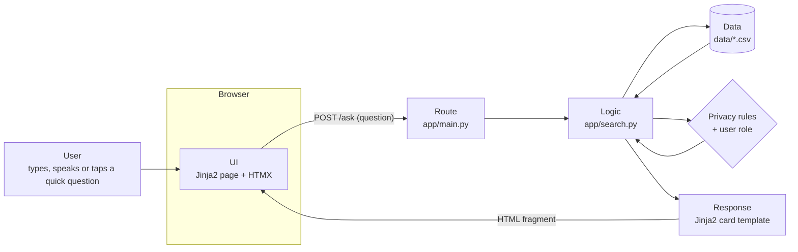

# Architecture: UI → logic → data → response

## Worked example: "Where is the ICT room?"

1. **UI:** the user types the question. HTMX sends `POST /ask` without reloading the page.
2. **Route** (`app/main.py`): reads the question and who is logged in, then calls the logic layer.
3. **Logic** (`app/search.py`):
   1. *Validate:* not empty, under 200 characters, contains letters or digits.
   2. *Normalise:* `"where is the ict room"` (lowercase, accents and punctuation removed).
   3. *Privacy rules:* no student name or personal-detail words, so it continues.
   4. *Intent:* the word "where" means **location**.
   5. *Spelling:* every word is known, so nothing is corrected.
   6. *Scoring:* each record gets points for matching phrases and keywords. Room B201's alias "ict room" is an exact phrase match, and rooms get a boost because the intent is *location*.
   7. *Answer:* B201 scores highest, so it is returned.
4. **Data** (`data/rooms.csv`): B201, ICT Room (Computer Lab), Science & Technology Building, Level 1, with directions.
5. **Response:** the room card shows the building, floor, step-by-step directions and a map with the route from the main gate. HTMX swaps it into the page, and the user can press **Read aloud**.

## The search pipeline (`app/search.py`)

| Step | What it does | Example |
|---|---|---|
| 1. Validate | Rejects empty, too long or symbol-only input | `"???"` → "Please use words" |
| 2. Help | Greetings show what the assistant can do | `"hi"` |
| 3. Privacy | Personal details, student lists and named students are checked against the user's role | `"Alex's phone number"` → refused |
| 4. Intent | Phrase lists in English and Vietnamese decide the topic | `"where"`, `"ở đâu"` → location |
| 5. Special rules | Time and date questions use the clock and calendar | `"what period is it now"`, `"events in December"` |
| 6. Spelling | Unknown words are matched to the closest known word with the same first letter; plurals also match the singular | `"unifrom"` → `"uniform"`, `"phones"` → `"phone"` |
| 7. Scoring | Phrase match = high points, keyword match = lower points; records matching the intent get ×1.5 + 2 | |
| 8. Answer | Only matches scoring at least 3 count. Otherwise "not found" and "Did you mean…?" | `"weather on Mars"` → not found |

### Names that are everyday words

Many Vietnamese names are also common words. "Khoa" also means "science" (khoa học), "Mai" means "tomorrow" (ngày mai), and "Đang" means "currently". Short or ambiguous names (listed in `AMBIGUOUS_NAMES`) only match a person when written with a title ("Mr Le") or as a full name. This stops "giáo viên khoa học" (science teacher) from matching a teacher named Khoa.

## Privacy and access model

| Who | Policies, staff, rooms, schedule, events, FAQs | Student profiles | Admin dashboard |
|---|---|---|---|
| Guest | ✅ | ❌ asked to log in | ❌ |
| Student | ✅ | Own profile only | ❌ |
| Teacher | ✅ | Students they teach (class, homeroom or club) | ❌ |
| Admin | ✅ | All | ✅ |

- Checks run **on the server** (`can_view_student` in `search.py` and the `/profile` route), so private data never reaches a browser that isn't allowed to see it.
- Student data is fictional and has no sensitive fields. A test checks for this.
- Questions asking for phone numbers, addresses, grades, passwords or medical details about a person are refused for every role.
- Passwords are salted PBKDF2-SHA256 hashes. Five failed logins lock the account for five minutes.
- The search log stores the role but never the username, and replaces blocked questions with `[private request]`.
- Security headers: Content-Security-Policy, X-Frame-Options, nosniff. All output is HTML-escaped by Jinja2.

## Why this stack

- **Readable:** Python and HTML templates, no build step. The logic is in one file.
- **Private by design:** a server-side app can refuse to send private data. A static site would ship every data file to the browser.
- **Fast:** pages are small HTML; HTMX is about 14 KB. A search takes a few milliseconds on the server; most of the wait is network time.
- **Testable:** pytest checks the logic and every route (`tests/`).
